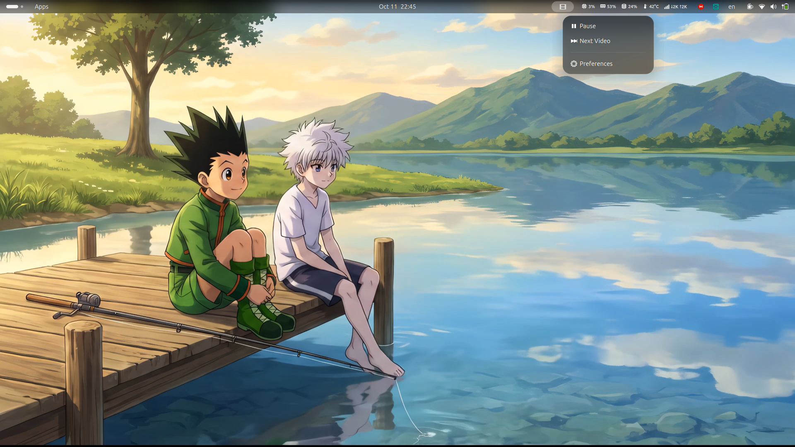

# Gink Video Wallpaper

Play videos and GIFs as your GNOME desktop wallpaper, with a separate wallpaper for each monitor.



## Features

- A video or GIF wallpaper for each monitor, with fill, fit or stretch placement.
- Playlists that change video on a timer, in order or shuffled.
- Shows a still frame of the video right away at login, then fades into playback.
- Can pause on battery, in the Overview, when windows cover the desktop, or while the screen is shared or accessed remotely.
- Optional display-sized copies of each video that use less power.
- A top bar menu with Play/Pause, Next Video and Preferences that also shows why the video paused automatically.
- When the extension is turned off, a still frame of the primary display's video stays as the wallpaper, placed the same way as the video.

## Requirements

- GNOME Shell 50 on Wayland.
- `mpv` plays the wallpaper.
- `ffmpeg` (which includes `ffprobe`) checks videos and creates still frames and optimized copies.
- Optional: VA-API drivers for hardware video decoding, which uses much less power.

| Distribution | Command |
|---|---|
| Ubuntu / Debian | `sudo apt install mpv ffmpeg` |
| Fedora | `sudo dnf install mpv ffmpeg` (from RPM Fusion) |
| Arch | `sudo pacman -S mpv ffmpeg` |

The **Diagnostics** page in the preferences shows whether each program and VA-API were found.

## Install

### From extensions.gnome.org

Search for **Gink Video Wallpaper** in Extension Manager, or install it from [extensions.gnome.org](https://extensions.gnome.org).

### From a release zip

```
gnome-extensions install --force gink-video-wallpaper@ginkcode.github.io.shell-extension.zip
```

Log out and back in, then run:

```
gnome-extensions enable gink-video-wallpaper@ginkcode.github.io
```

### From source

```
git clone https://github.com/ginkcode/gnome-video-wallpaper.git
cd gnome-video-wallpaper
make install
```

Log out and back in, then enable the extension. On Wayland, GNOME Shell only loads new or updated extension code after you log in again. `make zip` builds the release zip in `dist/`.

## Usage

Open the preferences from the top bar menu, Extension Manager, or `gnome-extensions prefs gink-video-wallpaper@ginkcode.github.io`.

- **Wallpapers** lists each display. Add videos or GIFs, choose the fit mode, and decide whether to play an optimized copy. With more than one video, the display plays them as a playlist. Click a video to preview it; the playing one is marked *Now playing*.
- **General** holds the startup delay, the pause rules, the playlist interval and order, the top bar menu, the default fit mode, the video output and debug logging.
- **Diagnostics** shows the installed programs, the cache size and a button to clear the cache.

Stills and optimized copies are stored in `~/.cache/gink-video-wallpaper`.

## Troubleshooting

- **A video does not play and the still or original wallpaper stays.** Open the preferences: the display shows the error. Check that `mpv` and `ffmpeg` are installed (see **Diagnostics**). Some distributions ship `ffmpeg` without patented codecs such as H.264 or HEVC. Install the full codec packages, or convert the video to VP9/AV1 WebM.
- **HDR videos are rejected.** Only SDR videos are supported. Convert the video to SDR first.
- **High CPU usage.** Hardware decoding needs working VA-API drivers (`vainfo` should list your GPU). A notification appears when playback falls back to CPU decoding. On Intel install `intel-media-va-driver`; on AMD `mesa-va-drivers`. Turn on **Optimize video** for large files.
- **NVIDIA.** The proprietary driver has no native VA-API support. Install `nvidia-vaapi-driver`, or expect software decoding and turn on optimized copies. If the video shows glitches, try another **Video output** under General → Playback → Advanced.
- **Hanabi.** Hanabi also draws a video wallpaper. The preferences show a banner with a button to disable it. Do not run both extensions.
- **Dash to Dock hides itself on an empty desktop.** Set Dash to Dock to *Intelligent autohide → Only maximized windows*, or turn intellihide off.
- **Blur My Shell makes the video darker.** This only happens when *Applications → Blur all applications* is on. Add `gink-video-wallpaper` to its application blacklist.
- **An update did not take effect.** Log out and back in.
- **Logs.** Turn on debug logging under General → Troubleshooting, then run `journalctl --user -f -o cat | grep gink-vw`.

More detail is in [docs/compatibility.md](docs/compatibility.md).

## Uninstall

```
gnome-extensions uninstall gink-video-wallpaper@ginkcode.github.io
rm -rf ~/.cache/gink-video-wallpaper
```

Disabling or uninstalling the extension keeps the still frame as your wallpaper. To get your previous wallpaper back, remove all videos in the preferences before disabling, or pick a new wallpaper in Settings.

## Support

If you enjoy the extension, you can [buy me a coffee](https://buymeacoffee.com/ginkcode).

## Contributing

See [CONTRIBUTING.md](CONTRIBUTING.md).

## License

[MIT](LICENSE)
